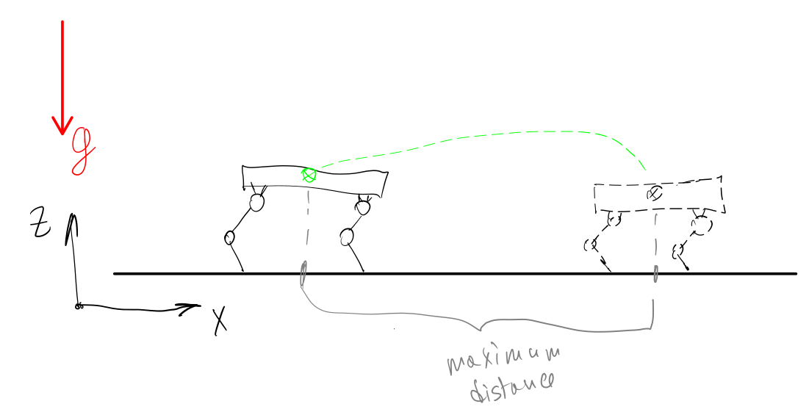

# Go2 planar jump (issue #54)

Flat (2D) quadruped Unitree Go2 in MuJoCo that jumps forward as far as possible.



> [!IMPORTANT]
> simulator <-> ROS 2 <-> controller

## Task

- **Robot and env:** Unitree Go2 on a flat floor.
- **2D control:** 3 of 6 base DoF are fixed (y, roll, yaw). The base can only move along x, z and rotate in pitch (`root_x`, `root_z`, `root_pitch` in `sim/go2_planar.xml`).
- **Goal:** maximum jump length, measured as the x-displacement of the robot's center of mass.

## Algorithm

Phase-based joint PD controller, `torque = Kp * (q_dest - q) - Kd * dq`:

| Time, s | Phase | Target pose | Kp |
|---|---|---|---|
| 0 – 2 | stand | home | 100 |
| 2 – 4 | squat | knee = `knee_sit` | 100 |
| 4 – 4.5 | push | thigh = `thigh_jump` | `kp_jump` |
| > 4.5 | flight and landing | home | 100 |

The three parameters are found by grid search (`sim/jump_search.py`) run directly in MuJoCo. Runs where the robot falls are rejected: base pitch > 0.3 rad or base lower than 0.25 m from the start height.

**Result:** TODO m with `knee_sit = TODO`, `thigh_jump = TODO`, `kp_jump = TODO`.

## Communication

Two ROS 2 nodes in lockstep, one message exchange per physics step:

| Topic | Direction | Type | Content |
|---|---|---|---|
| `/joint_states` | simulator → controller | `sensor_msgs/JointState` | 12 joint positions and velocities, sim time in `header.stamp` |
| `/joint_commands` | controller → simulator | `sensor_msgs/JointState` | 12 joint torques in `effort`, same `header.stamp` |

The simulator makes a physics step only after it receives torques. A 0.5 s timer re-sends the state if the controller does not answer, for example while the nodes are still discovering each other at startup.

## Structure

```
go2_jump/
├── config.py               # path to the model
├── sim/
│   ├── scene.xml           # floor, light, side camera
│   ├── go2_planar.xml      # Go2 with 3 fixed base DoF
│   ├── assets/             # meshes
│   ├── simulator_node.py   # MuJoCo + viewer, ROS 2 node
│   └── jump_search.py      # grid search of jump parameters
└── control/
    └── controller_node.py  # phase-based PD controller, ROS 2 node
```

## Install

Requires ROS 2 (tested on Jazzy). `rclpy` comes with ROS and is not installed with pip.

```bash
source /opt/ros/jazzy/setup.bash
pip install -r requirements.txt
```

Inside a Docker container with Ubuntu 24.04, add `--break-system-packages` to the pip command.

## Run

From `examples/go2_jump`, in two terminals (each after `source /opt/ros/jazzy/setup.bash`):

```bash
python3 -m control.controller_node
```
```bash
python3 -m sim.simulator_node
```

The start order does not matter. The jump length is printed when the viewer window is closed.

Parameter search (without ROS):

```bash
python3 -m sim.jump_search
```

Note. For Ubuntu 26.04 and Wayland use `PYGLFW_LIBRARY_VARIANT=wayland python3 -m sim.simulator_node`.

## Acknowledgments

Go2 model is taken from [MuJoCo Menagerie](https://github.com/google-deepmind/mujoco_menagerie) (see its license) and modified: base reduced to planar motion.
